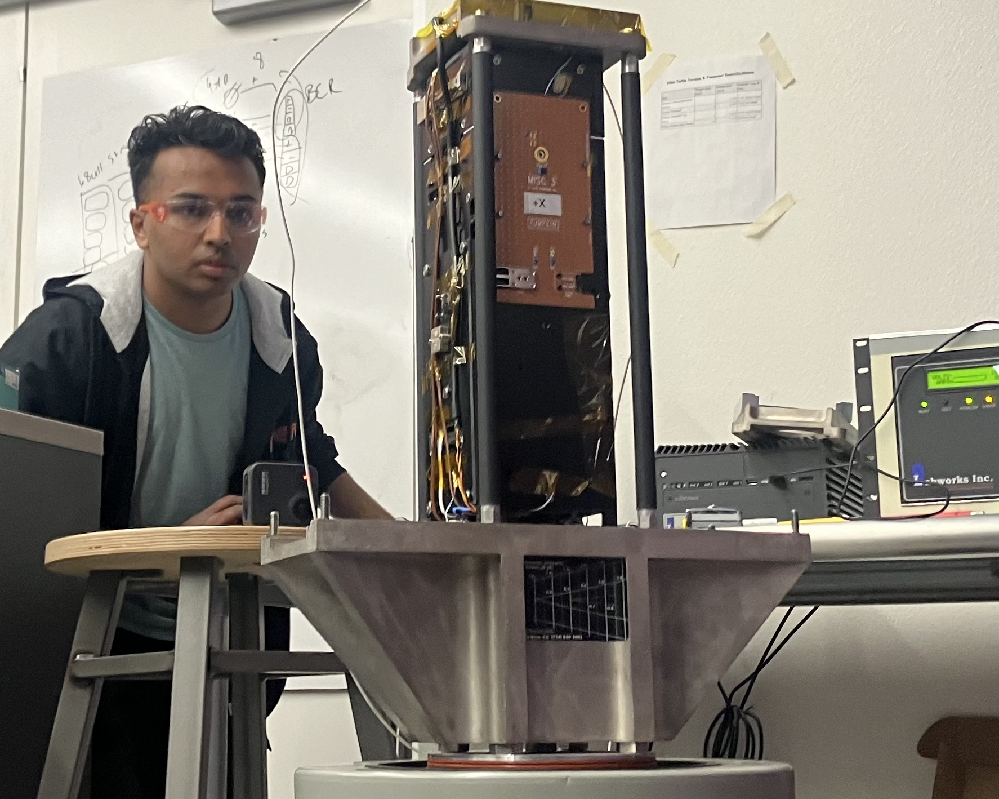

The lab supports and leads smallsat missions proposed by ASU students, faculty, and partners. 

# IPL Missions

| Mission Name | Date | Mission | Size  | IPL Contribution | Funding | 
| [SPARCS](https://sparcs.asu.edu/) | 2017 - present; launched January 2026 | UV Space Telescope | 6U | Iridium Integration, AIT and Operations Support | NASA SMD   
| [DORA](/missions/DORA) | 2019 - 2025 | Novel laser receiver, Low frequency radio testbed| 3U | AIT and Operations | NASA SSTP | 
| [Lightcube](/missions/Lightcube) | 2017 - 2023 | Naked Eye flash, CSLI | 1U | Entirely Student powered, Faculty Oversight | IPL Internal | 
| [Phoenix](https://phxcubesat.asu.edu/) | 2016 - 2020 | Thermal imager, CSLI | 3U | Entirely Student Powered, Faculty PI/Advised | NASA USIP | 
| 

<table>
<tr>
<td>ASU/IPL Alum Jaime Sanchez
de la Vega with Lightcube (2022)</td>
<td>AASU IPL Student Engineer oversees DORA vibration testing
(2023))</td>
<td>A ASU IPL Student Engineers Sam Cherian and
Christopher McCormick working on SPARCS)</td>
</tr>
</table>

